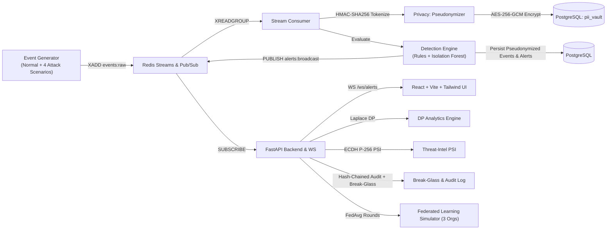

# Privacy-Preserving Real-Time Threat Detection Platform — Architecture & Implementation Plan

## 1. System Architecture

The platform ingests live security telemetry (`auth_log`, `network_flow`, `file_hash`), strips and tokenizes personally identifiable information (PII) before persistence or analyst inspection, detects threats in under 1 second using deterministic rules plus an Isolation Forest anomaly detector, and enforces cryptographic privacy guarantees across analytics, threat-intel lookups, cross-org model training, and break-glass re-identification.



### Core Design Principles
- **Privacy by Default**: Raw usernames, emails, and IP addresses never appear in the `security_events` table, `alerts` table, WebSocket broadcasts, or standard analyst API responses. Only HMAC-SHA256 tokens (`usr_*`, `eml_*`, `ip_*`) leave the ingestion boundary.
- **Zero-Trust Break-Glass**: Re-identification requires dual control (`analyst` requests with justification -> `privacy_officer` or distinct `admin` approves), generates a time-bounded grant, decrypts only the requested tokens from the AES-256-GCM vault, and appends hash-chained entries to `audit_logs`.
- **No Hardcoded Secrets**: JWT signing keys, HMAC rotation secrets, and AES-256-GCM vault keys are sourced exclusively from environment variables / key storage.
- **Cross-Environment Portability**: Docker Compose orchestrates PostgreSQL 16, Redis 7, Backend API, Stream Consumer, Event Generator, and Frontend Nginx/Vite. Local development and CI also support SQLite + embedded TCP Redis (`fakeredis`) without code changes in domain logic.

---

## 2. Folder Structure

```text
.
├── PLAN.md
├── README.md
├── Makefile
├── .env.example
├── docker-compose.yml
├── backend/
│   ├── Dockerfile
│   ├── pyproject.toml
│   ├── alembic.ini
│   ├── alembic/
│   │   ├── env.py
│   │   └── versions/
│   ├── app/
│   │   ├── __init__.py
│   │   ├── main.py
│   │   ├── api/
│   │   │   ├── __init__.py
│   │   │   ├── deps.py
│   │   │   ├── auth.py
│   │   │   ├── events.py
│   │   │   ├── alerts.py
│   │   │   ├── analytics.py
│   │   │   ├── privacy.py
│   │   │   ├── federated.py
│   │   │   └── ws.py
│   │   ├── core/
│   │   │   ├── __init__.py
│   │   │   ├── config.py
│   │   │   ├── database.py
│   │   │   ├── security.py
│   │   │   └── rate_limit.py
│   │   ├── models/
│   │   │   ├── __init__.py
│   │   │   ├── db.py
│   │   │   └── schemas.py
│   │   ├── privacy/
│   │   │   ├── __init__.py
│   │   │   ├── pseudonymizer.py
│   │   │   ├── vault.py
│   │   │   ├── differential_privacy.py
│   │   │   ├── psi.py
│   │   │   ├── audit.py
│   │   │   └── retention.py
│   │   ├── detection/
│   │   │   ├── __init__.py
│   │   │   ├── mitre.py
│   │   │   ├── rules.py
│   │   │   ├── ml_model.py
│   │   │   ├── engine.py
│   │   │   └── federated.py
│   │   └── streaming/
│   │       ├── __init__.py
│   │       ├── broker.py
│   │       ├── consumer.py
│   │       └── generator.py
│   └── tests/
│       ├── conftest.py
│       ├── test_privacy_pseudonymizer_vault.py
│       ├── test_privacy_dp.py
│       ├── test_privacy_psi.py
│       ├── test_privacy_audit_retention.py
│       ├── test_detection_rules_ml.py
│       ├── test_federated.py
│       ├── test_streaming.py
│       └── test_api_integration.py
├── frontend/
│   ├── Dockerfile
│   ├── package.json
│   ├── tsconfig.json
│   ├── vite.config.ts
│   ├── tailwind.config.js
│   ├── playwright.config.ts
│   ├── e2e/
│   │   └── threat_platform.spec.ts
│   └── src/
│       ├── main.tsx
│       ├── App.tsx
│       ├── api/
│       ├── context/
│       ├── components/
│       ├── pages/
│       ├── utils/
│       └── __tests__/
└── scripts/
    ├── seed_db.py
    └── run_local_stack.py
```

---

## 3. Data Models (PostgreSQL + SQLAlchemy 2 + Alembic)

1. **`users`**: `id` (UUID str), `username`, `email`, `hashed_password`, `role` (`viewer` | `analyst` | `privacy_officer` | `admin`), `is_active`, `created_at`.
2. **`hmac_keys`**: `id`, `key_id` (unique str e.g. `k_v1`), `encrypted_key_material` (encrypted with vault master key), `is_active`, `created_at`, `rotated_at`, `expires_at`.
3. **`pii_vault`**: `id`, `token` (indexed unique per `key_id`), `entity_type` (`username` | `email` | `ip`), `key_id`, `nonce` (12 bytes), `ciphertext` (AES-256-GCM encrypted raw value + tag), `created_at`, `expires_at`.
4. **`security_events`**: `id`, `event_type` (`auth_log` | `network_flow` | `file_hash`), `timestamp`, `region`, `username_token`, `email_token`, `source_ip_token`, `dest_ip_token`, `dest_port`, `bytes_out`, `auth_success`, `file_hash`, `anomaly_score`, `is_anomaly`, `raw_metadata` (sanitized non-PII JSON), `created_at`.
5. **`alerts`**: `id`, `title`, `severity` (`low` | `medium` | `high` | `critical`), `status` (`new` | `investigating` | `resolved`), `rule_id`, `mitre_technique_id`, `mitre_technique_name`, `mitre_tactic`, `explanation`, `anomaly_score`, `entity_tokens` (JSON list of `{type, token}`), `event_ids` (JSON list), `region`, `created_at`, `updated_at`.
6. **`reidentification_requests`**: `id`, `alert_id` (FK -> alerts), `requester_id` (FK -> users), `reviewer_id` (nullable FK -> users), `requested_tokens` (JSON list), `justification`, `status` (`pending` | `approved` | `rejected` | `expired`), `decision_note`, `created_at`, `reviewed_at`, `expires_at`.
7. **`audit_logs`**: `id` (auto-increment sequence for deterministic chaining), `timestamp`, `actor_id`, `actor_role`, `action`, `resource_type`, `resource_id`, `details` (JSON, never raw PII), `prev_hash` (SHA-256 hex), `entry_hash` (SHA-256 hex of canonical payload + `prev_hash`). Append-only.
8. **`privacy_settings`**: `id` (singleton `1`), `dp_epsilon` (float, default `1.0`), `retention_days` (int, default `30`), `hmac_rotation_hours` (int, default `24`), `updated_at`, `updated_by`.
9. **`event_daily_aggregates`**: `id`, `bucket_date`, `region`, `event_type`, `event_count`, `alert_count`, `created_at` (retained after raw event minimization).
10. **`threat_intel_hashes`**: `id`, `sha256_hash` (indexed), `malware_family`, `severity`, `source`, `created_at`.
11. **`federated_rounds`**: `id`, `round_number`, `global_accuracy`, `global_loss`, `org_metrics` (JSON for `Org-Alpha`, `Org-Beta`, `Org-Gamma`), `model_weights` (JSON), `created_at`.

---

## 4. API Endpoints

### Auth (`/api/v1/auth`)
- `POST /login` — Issue JWT access token (`role` claims, rate-limited).
- `GET /me` — Current authenticated user profile & permissions.
- `GET /users` — List users (`admin` / `privacy_officer`).

### Events & Simulation (`/api/v1/events`)
- `POST /ingest` — Ingest single/batch event into Redis Streams (`analyst`, `admin`).
- `GET /` — List recent pseudonymized events with filtering.
- `POST /simulate` — Trigger simulated normal traffic or specific attack scenario (`brute_force`, `impossible_travel`, `data_exfiltration`, `port_scan`, `malicious_hash`) (`analyst`, `admin`).

### Alerts (`/api/v1/alerts`)
- `GET /` — Paginated alert list with status/severity/MITRE filters.
- `GET /{alert_id}` — Alert details, timeline of pseudonymized events, entity tokens, and user's re-identification grant status.
- `PATCH /{alert_id}/status` — Update alert status (`new`, `investigating`, `resolved`) (`analyst`, `admin`), logged to audit log.

### Analytics & Differential Privacy (`/api/v1/analytics`)
- `GET /dashboard` — DP-noised aggregate stats (region counts, top-N pseudonymized source IPs, severity distribution, recent event-rate buckets) using configured `epsilon` and Laplace noise.

### Privacy Console & Break-Glass (`/api/v1/privacy`)
- `GET /settings` — Current epsilon, retention days, rotation schedule, active HMAC `key_id`.
- `PATCH /settings/epsilon` — Update DP epsilon (`privacy_officer`, `admin`), audited.
- `POST /keys/rotate` — Rotate active HMAC-SHA256 pseudonymization key (`privacy_officer`, `admin`), audited.
- `POST /reidentify/request` — Analyst submits break-glass request with justification for an alert's tokens.
- `GET /reidentify/requests` — List pending/historical break-glass requests (`analyst` sees own; `privacy_officer`/`admin` see all).
- `POST /reidentify/requests/{req_id}/decide` — Approve or reject request (`privacy_officer` or distinct `admin`, enforcing separation of duties).
- `POST /reidentify/requests/{req_id}/reveal` — Decrypt vault entries for an approved, unexpired request (`requester` or `privacy_officer`), audited.
- `GET /audit-log` — View hash-chained audit logs (`privacy_officer`, `admin`).
- `GET /audit-log/verify` — Cryptographically verify entire audit log hash chain.
- `POST /retention/run` — Execute data minimization / aggregation + purge job (`privacy_officer`, `admin`).
- `POST /psi/check` — ECDH-P256 Private Set Intersection endpoint: accepts client-blinded curve points, returns double-blinded client hashes + shuffled server-blinded points without exposing the raw threat-intel list.
- `GET /psi/sample-hashes` — Returns anonymized demo instructions + a few test hashes (1 benign, 1 known bad indicator hash) for UI demonstration without exposing the threat-intel database.

### Federated Learning (`/api/v1/federated`)
- `GET /status` — Latest global accuracy, round history, and per-org stats (`Org-Alpha`, `Org-Beta`, `Org-Gamma`).
- `POST /train-round` — Execute 1 or N local training rounds across 3 virtual orgs and aggregate via FedAvg (`analyst`, `privacy_officer`, `admin`).
- `POST /reset` — Reset global model and round history (`admin`).

### WebSocket (`/ws/alerts`)
- Authenticates via JWT query param `token`, streams real-time alerts and per-second event-rate/alert telemetry ticks pushed by the Redis Pub/Sub subscriber.

---

## 5. Milestones & Execution Order

1. **Milestone 1 — Infra & Project Scaffold**: `docker-compose.yml`, `Dockerfile`s, `Makefile`, `.env.example`, `backend/pyproject.toml`, `frontend/package.json`.
2. **Milestone 2 — Backend Core & Data Models**: `core/` (`config`, `database`, `security`, `rate_limit`), `models/` (`db`, `schemas`), Alembic config & initial migration, seed helper.
3. **Milestone 3 — Privacy Module (`privacy/`)**: Rotating HMAC pseudonymizer, AES-256-GCM vault, Laplace differential privacy, ECDH P-256 PSI, hash-chained audit log, retention job + >= 80% test coverage.
4. **Milestone 4 — Detection Engine & Federated Learning (`detection/`)**: MITRE ATT&CK mappings, stateful/stateless rule engine (brute force, impossible travel, data exfiltration, port scan, threat-intel hash), Isolation Forest ML anomaly scorer, 3-org FedAvg simulator + >= 80% test coverage.
5. **Milestone 5 — Streaming Pipeline (`streaming/`)**: Redis Streams producer/consumer/PubSub abstraction, real-time consumer worker (<1s pipeline), realistic normal + 4 attack event generator + tests.
6. **Milestone 6 — FastAPI REST & WebSocket API (`api/`)**: Auth/RBAC, Events, Alerts, DP Analytics, Privacy Console endpoints, PSI, FL, WebSocket broadcaster + API integration tests.
7. **Milestone 7 — Frontend (`frontend/`)**: Login + RBAC UI, Live Dashboard (WS feed, Recharts event rate, DP stats), Alert Detail + Break-Glass Re-identification, Privacy Console (epsilon slider, approvals, audit verifier, key rotation, retention, PSI checker), Federated Learning view + Vitest tests.
8. **Milestone 8 — E2E Verification & Docs**: Playwright E2E tests, full-stack live attack simulation -> dashboard alert verification, `README.md` with Mermaid diagram, threat model, and privacy limitations.
