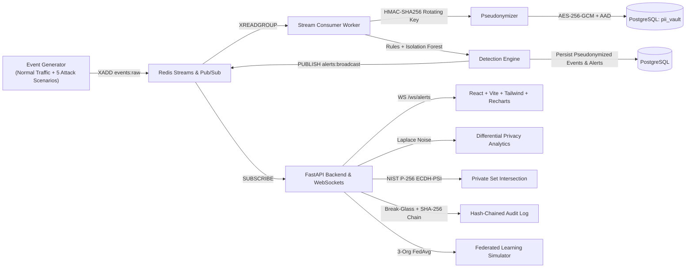

# AegisVault — Privacy-Preserving Real-Time Threat Detection Platform

A full-stack Security Operations Center (SOC) platform that ingests live security telemetry (`auth_log`, `network_flow`, `file_hash`), detects attacks in under 1 second using deterministic rules plus an Isolation Forest anomaly detector, and enforces **privacy by design**: analysts operate strictly on HMAC-SHA256 pseudonymized entities while raw identifiers remain locked inside an AES-256-GCM vault accessible only through dual-control break-glass approval.

---

## Architecture



### Module Layout
- `backend/app/core/`: Environment config (`Pydantic Settings`), SQLAlchemy 2 engine, JWT + Argon2id RBAC (`viewer`, `analyst`, `privacy_officer`, `admin`), sliding-window rate limiter, DB bootstrap.
- `backend/app/models/`: SQLAlchemy 2 ORM models (11 tables) + Alembic migrations + Pydantic v2 schemas.
- `backend/app/privacy/`: Rotating HMAC-SHA256 pseudonymization, AES-256-GCM vault, Laplace differential privacy, NIST P-256 ECDH Private Set Intersection, SHA-256 hash-chained audit trail, and data minimization retention job.
- `backend/app/detection/`: MITRE ATT&CK taxonomy, stateful/stateless rule engine (`T1110` Brute Force, `T1078` Impossible Travel, `T1041` Data Exfiltration, `T1046` Port Scan, `T1204.002` Malicious File Hash), `scikit-learn` `IsolationForest` scorer, and 3-organization `FedAvg` simulator.
- `backend/app/streaming/`: Redis Streams (`XADD`, `XREADGROUP`, `XACK`) + Pub/Sub broker (with in-memory broker mode for unit tests/local single-process dev), sub-second consumer worker, and attack/traffic generator.
- `backend/app/api/`: Versioned REST endpoints (`/api/v1/*`) and authenticated `/ws/alerts` WebSocket fanout.
- `frontend/`: React 18, TypeScript, Vite, Tailwind CSS, Recharts, WebCrypto/BigInt client-side ECDH-PSI blinding, Vitest, and Playwright E2E tests.

---

## Quickstart

### Option 1: Docker Compose (Recommended Production Stack)
Requires Docker Engine + Docker Compose + `make`:

```bash
# 1. Generate .env with fresh cryptographic keys and start PostgreSQL, Redis, Backend, Consumer, Generator, Frontend
make up

# 2. Trigger an attack simulation burst (brute force, impossible travel, data exfiltration, port scan, malicious hash)
make demo

# 3. Run backend + frontend unit tests
make test

# 4. Stop services
make down
```

Open **http://localhost:5173** (API Swagger docs at **http://localhost:8000/docs**).

### Option 2: Local Execution (Without Docker)
1. Generate `.env`:
   ```bash
   python scripts/ensure_env.py
   ```
2. Install dependencies:
   ```bash
   cd backend && uv venv --python 3.12 .venv && uv pip install --python .venv/Scripts/python.exe -e ".[dev]"
   cd ../frontend && npm install
   ```
3. Launch the local stack (runs Alembic migrations + FastAPI + embedded stream worker + Vite):
   ```bash
   python scripts/run_local_stack.py
   ```
4. Run Playwright E2E tests end-to-end against the live stack:
   ```bash
   python scripts/run_local_stack.py --e2e
   ```

### Demo Accounts
Passwords are read from `DEMO_USER_PASSWORD` in `.env` (generated by `scripts/ensure_env.py` when running `make up`):
- `viewer`: Read-only access to pseudonymized dashboard, alerts, DP stats, and FL status.
- `analyst`: Can simulate attacks, triage alerts (`new` -> `investigating` -> `resolved`), run FL rounds, and submit break-glass re-identification requests.
- `officer` (`privacy_officer`): Can tune DP `epsilon`, rotate HMAC keys, run data retention purges, approve/reject break-glass requests, and inspect/verify the hash-chained audit log.
- `admin`: Full administrative and operational access (cannot self-approve own break-glass requests due to separation-of-duties checks).

---

## Threat Model

| Asset / Threat | Mitigation Implemented | Residual Risk |
|---|---|---|
| **Database Compromise / Insider Snooping** | Raw usernames, emails, and IPs are stripped before persistence; events and alerts store only HMAC-SHA256 tokens (`usr_*`, `eml_*`, `ip_*`). Raw values live only in `pii_vault` encrypted with AES-256-GCM + AAD binding (`entity_type:key_id:token`). | If an attacker compromises both the PostgreSQL database **and** `VAULT_MASTER_KEY_B64`, vault entries can be decrypted. Use an external KMS/HSM in production. |
| **Token Linkability Across Epochs** | HMAC keys rotate via `kv1 -> kv2 -> ...` on a schedule (`HMAC_ROTATION_HOURS`) or manually via Privacy Console, breaking long-term cross-epoch correlation. | Within a single key epoch, identical inputs yield the same token so stateful rules (brute force, impossible travel, port scan) can correlate activity. |
| **Aggregate Reconstruction / Differencing Attacks** | Dashboard aggregates (totals, regional counts, severity histograms, top-N sources) add Laplace noise scaled by `sensitivity / (epsilon / 4)`. | Repeated queries without an enforced cumulative per-user privacy budget accountant can gradually average out noise over many refreshes. |
| **Threat-Intel Database Exfiltration** | File hash checks use two-round NIST P-256 ECDH-PSI; clients blind candidate hashes in the browser (`utils/psi.ts`) and never download raw server hashes. | Server reveals `server_set_size` (cardinality) and server-blinded curve points; brute-forcing arbitrary guesses still requires online API queries (mitigated by rate limiting). |
| **Unauthorized Re-identification / Log Tampering** | Break-glass requires justification + distinct `privacy_officer`/`admin` approval (enforcing separation of duties), time-limited TTL, and append-only SHA-256 hash-chained audit logs (`prev_hash` -> `entry_hash`). | A database superuser with `DELETE`/`UPDATE` privileges could rewrite the entire chain from genesis unless audit logs are also shipped to WORM/immutable external storage. |
| **API Abuse & Credential Stuffing** | Sliding-window rate limiting middleware (`429 Too Many Requests`), strict Pydantic v2 validation, Argon2id password hashing, JWT role verification. | In-memory rate limiter is per API worker; multi-replica deployments should share rate-limit state in Redis. |

---

## Known Limitations of Each Privacy Technique

1. **HMAC-SHA256 Pseudonymization + AES-256-GCM Vault**:
   - Deterministic tokenization within a key epoch is required for behavioral correlation (e.g., counting 5 failed logins from the same IP), which permits frequency analysis inside that epoch.
   - Low-entropy identifiers (e.g., predictable usernames or small IPv4 `/24` ranges) would be vulnerable to offline dictionary attacks if the HMAC secret key leaked.
2. **Laplace Differential Privacy**:
   - The dashboard splits configured `epsilon` across 4 panels per snapshot (`epsilon / 4`), providing per-snapshot $\varepsilon$-DP, but does not block an analyst from refreshing indefinitely (no hard lifetime privacy budget lockout in demo mode).
   - Clamping negative noisy counts to `0` preserves $\varepsilon$-DP (post-processing invariance) but introduces slight positive bias when true counts are very small (`0`–`3`).
3. **ECDH-Based Private Set Intersection (NIST P-256)**:
   - Reveals set intersection and server indicator cardinality (`server_set_size`), and assumes semi-honest client behavior (does not prevent a malicious client from querying a dictionary of candidate hashes beyond API rate limits).
   - Pure-BigInt/Python scalar multiplication is intended for educational/medium-scale threat-intel sets (`< 10k` indicators) rather than multi-million-indicator streaming joins.
4. **Federated Learning (FedAvg)**:
   - Averages unperturbed model weights (`coef_`, `intercept_`) across 3 virtual organizations; in production adversarial settings, raw gradient/weight updates without Secure Aggregation or local DP (`DP-SGD`) can still leak membership/property inference signals.
5. **Break-Glass & Retention Policy**:
   - Retention policy operates on an explicit trigger or scheduled worker; vault entries linked to active, unexpired break-glass grants are intentionally preserved until grant expiry.
